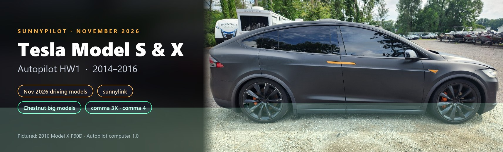

<p align="center">
  
</p>

<p align="center">
  <a href="https://github.com/sunnypilot/sunnypilot"></a>
  
  
  
  
</p>

<p align="center">
  <b>sunnypilot with the newest driving models for the Tesla Model S / X with Autopilot 1 (2014-2016).</b><br>
  Install on a comma 4 or 3X in one step, switch models from the sunnylink app, plug in a Chestnut for the big models.
</p>

---

## Install

On the comma: **Settings → Software → Uninstall**, then on the setup screen choose **Custom Software** and enter:

```
mobilefoodexperts/sunnypilot-nov-2026
```

Keep the comma on car power while it builds the first time (about 10-15 minutes). Then:

| Step | Where |
|---|---|
| Turn on **Show Advanced Controls**, set **Max Offroad Time** to 5 min | Settings → Device |
| Enable sunnylink, pair it, back up your settings | Settings → sunnylink |
| Pick a driving model (start with the default) | Settings → Models, or the sunnylink app |

> **Experimental:** not yet road-tested on this branch. Check the [first-drive list](docs/TESLA_HW1_FORK_BUILD.md#check-on-the-first-hw1-drive-from-the-nov-25-2026-car-code-review) before relying on it.

<details>
<summary>Install over SSH instead</summary>

Generate an SSH key (`ssh-keygen -t ed25519`), add it to GitHub, then on the device go to **Settings > Developer > SSH Keys** and enter your GitHub username. SSH into the device (`ssh comma@<device-ip>`) and run:

```bash
cd /data && rm -rf openpilot
git clone --depth 1 --shallow-submodules --recurse-submodules -b sunnypilot-nov-2026 https://github.com/mobilefoodexperts/openpilot.git openpilot
cd openpilot
op setup
op build -j2 2>&1 | tee /data/build.log
sudo reboot
```
If AGNOS versions differ, `op fork <N>` updates the OS automatically before reboot. No `fork` after swap? Run `/data/forks/mobilefoodexperts_openpilot/tools/op.sh fork list`.
</details>

## How it fits together

<p align="center">
  
</p>

| You need | |
|---|---|
| **Car** | Tesla Model S / X with Autopilot HW1 (Model S 2015, Model X 2016 tested on the original fork). HW2 may work, untested. Pre-AP not supported. |
| **Device** | comma 4 or comma 3X |
| **Harness** | [xnor harness](https://xnor.shop) |
| **Optional** | Chestnut external GPU for the big models |

## What's in this build

| | |
|---|---|
| **Driving models** | sunnypilot's current lists (`driving_models_v25`, `driving_models_chestnut_v28`, selector 21). New models appear automatically. |
| **sunnylink** | Unchanged from sunnypilot: pairing, settings, backup, switching models from the app. |
| **Tesla HW1 car code** | [`mobilefoodexperts/opendbc`](https://github.com/mobilefoodexperts/opendbc/tree/sunnypilot-nov-2026): HW1 platforms and `teslaLegacy` panda safety, merged with sunnypilot's opendbc. |
| **Chestnut** | sunnypilot's big-model support. The original fork's Chestnut add-ons are being ported on [`sunnypilot-nov-2026-chestnut`](https://github.com/mobilefoodexperts/openpilot/tree/sunnypilot-nov-2026-chestnut). |
| **PitStop** | Local web UI on the comma (port 8082); changes only allowed while the car is off. |
| **`op fork`** | Switch between forks from the command line. |
| **Prebuilt** | A `-prebuilt` branch for faster installs is built on a comma; see the build guide. |

Rules for future builds, how this branch is updated to newer sunnypilot, and lessons from the sunnypilot forum: **[docs/TESLA_HW1_FORK_BUILD.md](docs/TESLA_HW1_FORK_BUILD.md)**.

## Credits

A fork of [sunnypilot/sunnypilot](https://github.com/sunnypilot/sunnypilot), itself a fork of [commaai/openpilot](https://github.com/commaai/openpilot). The Tesla HW1 work comes from [P6g9YHK6/SunnyPilot-TeslaHW1](https://github.com/P6g9YHK6/SunnyPilot-TeslaHW1), based on [xnor](https://github.com/xnor-tech/openpilot) and the successor of [Tinkla (Unity)](https://github.com/BogGyver/openpilot). Tesla, Model S and Model X are trademarks of Tesla, Inc.; this project is not affiliated with Tesla or comma.ai. The banner photo is the maintainer's own 2016 Model X (HW1).

## Upstream Updates
| Upstream | Branch | Last Commit |
|----------|--------|-------------|
| [sunnypilot/sunnypilot](https://github.com/sunnypilot/sunnypilot) | `master` | `6732fcc52` (2026-11-25) |
| [sunnypilot/opendbc](https://github.com/sunnypilot/opendbc) | `master` | `b928e4a2` (2026-11-25) |
| [xnor-tech/openpilot](https://github.com/xnor-tech/openpilot) | `xnor-dev` | `eae878da2` (2026-04-25) |
| [xnor-tech/opendbc](https://github.com/xnor-tech/opendbc) | `master-xnor` | `78039539` (2026-04-25) |
| [xnor-tech/panda](https://github.com/xnor-tech/panda) | `master-xnor` | `56920ec6` (2026-04-11) |

## Tesla Documentation
| File | Purpose |
|------|---------|
| [`imports_to_maintain.md`](https://github.com/mobilefoodexperts/opendbc/blob/sunnypilot-nov-2026/opendbc/car/tesla/imports_to_maintain.md) | Tracks all HW1 changes from xnor-tech/StarPilot that must be preserved across upstream merges, with diff commands and merge checklist |
| [`todo_HW1.md`](https://github.com/mobilefoodexperts/opendbc/blob/sunnypilot-nov-2026/opendbc/car/tesla/todo_HW1.md) | Comprehensive improvement TODO list for Tesla HW1 (AP1) (Model S/X 2014-16) covering missing signals, safety, longitudinal/lateral control, UI, and more |

## Roadmap (from the original fork)
- **Support for Tesla Legacy:** Yes
- **`op fork`:** Yes
- **Bridge Toggle:** Yes
- **Planned:**
  - [ ] Feature parity with other openpilot-supported cars
  - [ ] HW2/AP2 support
  - [ ] Pre-AP support
  - [ ] Local web UI independent from SunnyLink
  - [ ] Prototype replacement of Tesla app

<h3>GitHub Sponsor</h3>

## Other Documentation
- [commaai/openpilot wiki - Tesla](https://github.com/commaai/openpilot/wiki/Tesla) — Official commaai documentation on Tesla hardware compatibility, flashing, and general openpilot/Tesla usage. Useful reference for HW1/HW2 support setup and troubleshooting.
- [CARS.md](https://github.com/commaai/openpilot/blob/master/docs/CARS.md) — Official list of supported vehicles and their feature coverage in openpilot.
